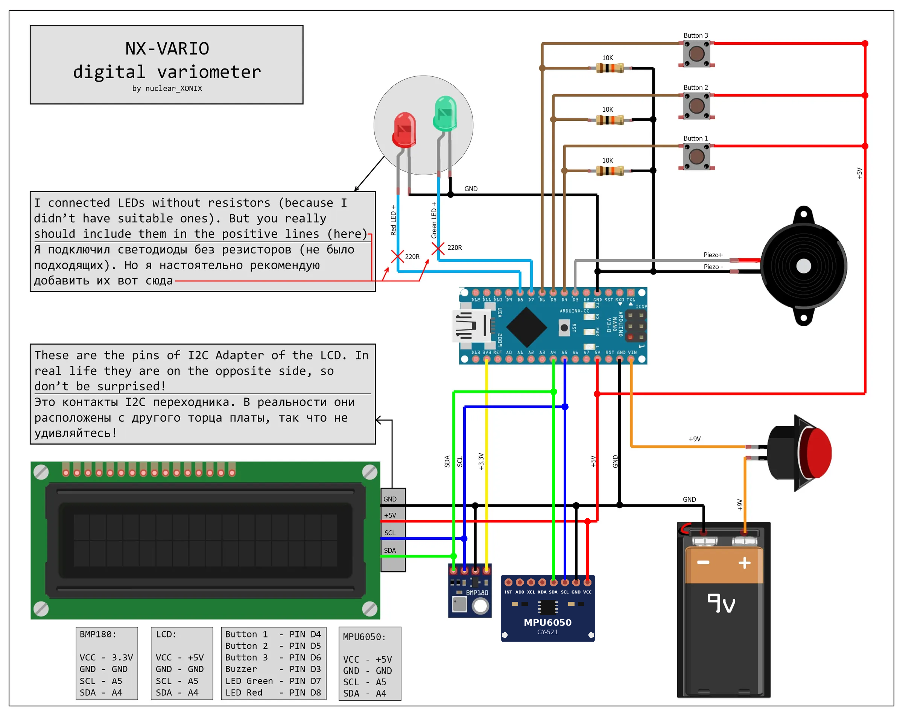

# NX-VARIO

Arduino Nano paragliding vario with baro/IMU fusion. Based on the original NX-VARIO by [XONIX2004](https://www.thingiverse.com/XONIX2004).

## Features

- **Fusion:** BMP180 + MPU6050, using a third-order complementary filter whose states are altitude, climb rate and accelerometer bias. The gain is selectable in the menu (Response). Response is about 50 ms.
- **Orientation:** the gravity vector is tracked with the gyro, and the accelerometer only corrects it when |a| is within 0.05 g of g0. This prevents false climb in turns.
- **Calibration:** 6-face accelerometer calibration (offset and scale per axis), stored in its own EEPROM block.
- **Audio:** Timer2 fast PWM on D3, with volume set by duty cycle.
  - Climb: pitch and beep rate follow the vario.
  - Sink: a continuous tone that drops with the sink rate.
  - Weak-lift buzzer: a continuous tone from the set value (−0.3 to 0.0 m/s, or OFF) up to the climb threshold. Pitch and volume both ramp up toward the climb tone.
- **Average:** 5–30 s, or OFF (live value).
- **Auto take-off and landing:** take-off at 10 m altitude change, or more than 0.5 m/s for 3 s. Audio is muted on the ground.
- **Settings:** stored in EEPROM, with a YES/NO save prompt when leaving the menu.

## Hardware

| Part | Pins |
|---|---|
| Arduino Nano (ATmega328P) | |
| BMP180, MPU6050, LCD1602 I2C | A4 SDA / A5 SCL |
| Passive buzzer | D3 (OC2B) |
| Buttons 1 / 2 / 3 | D4 / D5 / D6, 10K pull-down (pressed = HIGH) |
| LED green / red | D7 / D8 |

## Libraries

`BMP180` (iarduino), `Bounce2`, `SBB_CLICK`, plus the display library:
- `nx_vario/` — Waveshare LCD1602 I2C (AiP31068L, 0x3E): `Waveshare_LCD1602`
- `nx_vario_lcd_i2c/` — standard 1602 + PCF8574 backpack (original NX-VARIO display, 0x27): `LiquidCrystal_I2C`

## Build notes

- Flash use is about 28.4 KB of 30 KB on the old bootloader, so there isn't much room left.
- Values marked `CAN BE CHANGED!!!` are the tuning parameters.
- Run the calibration (menu 11) once after assembly. Place the vario still on each face and press button 3.

## Files

- `nx_vario/` — firmware, Waveshare display.
- `nx_vario_lcd_i2c/` — same firmware, standard I2C 1602 display.
- `tools/mpu_test_v1/` — MPU6050 test sketch.
- `docs/wiring.png` — wiring diagram.

The commit history contains every version from the original sketch onward.

## Credits

The original NX-VARIO design, firmware and case are by **XONIX2004**: https://www.thingiverse.com/XONIX2004
